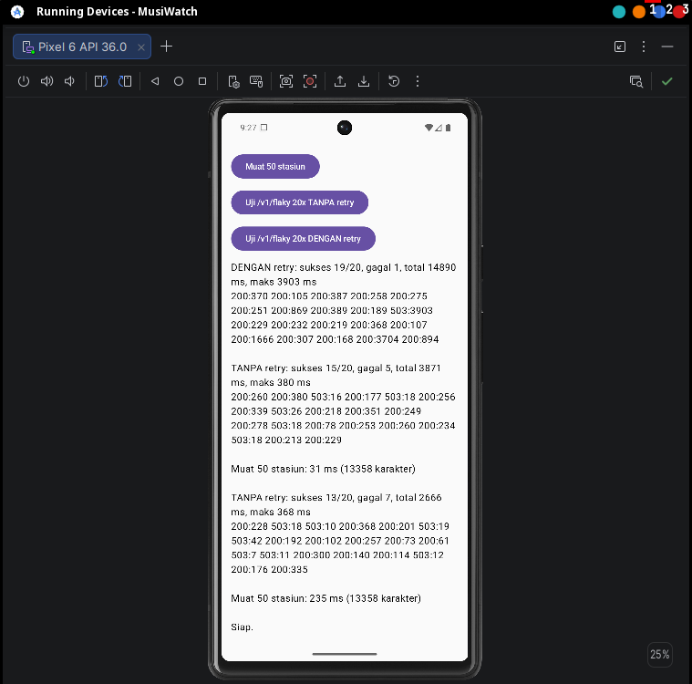

# Lembar Kerja Praktik 1 - API dan Latency

Nama/NIM: 
- M.Prakarsa Al Islam (09011282328043)
- Aulia Putri Raffliana (09011182328004)
- Aisyah Putri Ramadhani Rafael (09011182328013)
- Dzakiy Erlang Hersiando (09011282328028)
- Dzaky Almer Antoriq (09011282328103)

Tag Git: p1-final

Lingkungan: Fedora Linux (laptop Intel i5 gen 6, RAM 16 GB); Python 3.14; Android Studio Rabbit 2; emulator Pixel 6, image Google APIs Intel x86_64 API 36; OkHttp 4.12.0.

## 1. (P1.1) Hasil pengukuran curl

Sumber data: `docs/p1_curl.csv`, dihasilkan `scripts/measure_latency.sh` dengan N=10 per kondisi. Server API berjalan di laptop yang sama (`http://localhost:8000`). Satuan waktu: milidetik, ditulis median / maksimum. Waktu `conn` dan `tls` yang dilaporkan curl bersifat kumulatif dari awal permintaan.

| Kondisi | dns (median/maks) | conn | tls | ttfb | total | size (byte) |
| --- | --- | --- | --- | --- | --- | --- |
| a tanpa kompresi (500 stasiun) | 0,03 / 0,04 | 0,35 / 0,50 | 0 / 0 | 14,7 / 33,1 | 14,9 / 33,3 | 133.812 |
| b kompresi gzip (500 stasiun) | 0,03 / 0,05 | 0,35 / 0,39 | 0 / 0 | 15,0 / 30,7 | 15,3 / 31,0 | 6.086 |
| c0 tanpa ETag (50 stasiun) | 0,03 / 0,04 | 0,39 / 0,50 | 0 / 0 | 3,5 / 5,2 | 3,7 / 5,3 | 13.358 |
| c ETag, respons 304 (50 stasiun) | 0,03 / 0,05 | 0,36 / 0,48 | 0 / 0 | 2,1 / 2,4 | 2,1 / 2,5 | 0 |
| d HTTPS, koneksi baru | 2,9 / 142,9 | 220,7 / 361,6 | 275,6 / 624,4 | 314,7 / 661,4 | 314,8 / 661,5 | 577 |
| d HTTPS, koneksi dipakai ulang | 0 / 0 | 0 / 0 | 0 / 0 | 52,3 / 57,3 | 99,6 / 116,2 | 577 |

Catatan pengukuran:
- Endpoint HTTPS dari dosen tidak tersedia, sehingga kondisi d memakai `https://example.com/` sebagai pengganti. Dua URL ke host yang sama dalam satu perintah curl membuat koneksi kedua dipakai ulang; baris dibedakan lewat kolom `koneksi_baru` (1 = baru, 0 = dipakai ulang).
- Skrip modul berhenti di langkah pengambilan ETag karena memakai `curl -sI` (metode HEAD), sedangkan endpoint hanya mendefinisikan GET sehingga menjawab 405 dan `set -e` menghentikan skrip. Perbaikan: ETag diambil lewat GET dengan `curl -s -D - -o /dev/null`. Saya juga menambahkan kondisi pembanding `c0_tanpa_etag` (halaman 50 stasiun tanpa `If-None-Match`) agar persentase penurunan akibat ETag dapat dihitung.
- Karena `time_connect` dan `time_appconnect` kumulatif, handshake TLS sekitar 275,6 - 220,7 = 55 ms dan TCP connect (termasuk DNS) sekitar 220 ms pada koneksi baru.

Penurunan size dan total akibat kompresi dan ETag (%):
- Kompresi gzip: size turun **95,5%** (133.812 -> 6.086 byte). Total justru naik sekitar 2,7% (14,9 -> 15,3 ms). Di localhost tidak ada jaringan yang lambat, sehingga waktu CPU untuk kompresi menutup penghematan transfer; manfaatnya muncul di jaringan lambat.
- ETag (respons 304): size turun **100%** (13.358 -> 0 byte) dan total turun **43%** (3,7 -> 2,1 ms).

Komponen latency yang hilang saat koneksi dipakai ulang: **DNS, TCP connect, dan TLS handshake** (ketiganya bernilai 0 pada koneksi dipakai ulang). Median ttfb turun dari 314,7 ms ke 52,3 ms, yaitu sekitar **83%**.

## 2. (P1.1) Durasi muat 50 stasiun dari aplikasi

Emulator Pixel 6 (API 36). Profil full, hsdpa dan edge dijalankan dengan `~/Android/Sdk/emulator/emulator -avd <nama_avd> -netspeed full -netdelay none -no-snapshot-load`, `emulator -avd <nama> -netspeed hsdpa -netdelay umts` dan `-netspeed edge -netdelay edge`. Tiap profil: 10 kali tekan "Muat 50 stasiun", aplikasi dimulai ulang sebelum tiap profil sehingga tekanan pertama memakai koneksi baru. Satuan: ms.

| Profil | Median (10 pengukuran) | Maks | Tekanan pertama (koneksi baru) | Median tanpa tekanan pertama |
| --- | --- | --- | --- | --- |
| full | 20,5 | 544 | 544 | 18 |
| hsdpa | 31,5 | 577 | 577 | 31 |
| edge | 159,5 | 726 | 726 | 139 |

Data mentah (urutan kronologis, tekanan pertama di awal):
- full: 544, 23, 18, 25, 14, 42, 38, 17, 16, 15
- hsdpa: 577, 36, 26, 27, 50, 31, 20, 67, 17, 32
- edge: 726, 139, 76, 449, 134, 180, 74, 247, 619, 94

Kesimpulan (dengan angka):
- Profil **edge** jelas lebih lambat: median 159,5 ms dibanding 20,5 ms pada full, sekitar **7,8 kali lebih lama**, dan sebarannya melebar (74-726 ms).
- Profil **hsdpa** hanya naik ke median 31,5 ms (sekitar 1,5 kali full). Selisih ini kecil dan masih dalam rentang derau pengukuran, sehingga pada pengukuran ini hsdpa tidak dapat dibedakan dengan tegas dari full. Penyebab yang mungkin: bandwidth hsdpa sudah tinggi sementara respons 50 stasiun kecil (13.358 karakter sebelum kompresi), dan jeda tambahan tidak terlihat jelas. Penjelasan ini dugaan, belum diuji.
- Pada **ketiga profil, tekanan pertama jauh lebih lambat** (544-726 ms) daripada tekanan berikutnya (median 18-139 ms). Itu mencakup pembukaan koneksi baru dan inisialisasi OkHttp dan JVM, sehingga angka ini tidak sepenuhnya milik koneksi. Meski begitu, urutan besarnya konsisten dengan hasil curl bahwa koneksi baru jauh lebih mahal daripada koneksi dipakai ulang.
- Optimasi yang paling berpengaruh pada jaringan lambat berdasarkan data ini: **memakai ulang koneksi** (menghindari biaya koneksi baru yang berkali-kali lebih besar daripada permintaan berikutnya; curl: ttfb turun sekitar 83%) dan **mengurangi byte** (kompresi mengurangi size 95,5% dan ETag menghilangkan isi respons 100%). Efek byte pada profil lambat tidak terukur langsung di aplikasi karena OkHttp otomatis meminta gzip dan payload kecil, jadi bukti untuk kompresi dan ETag berasal dari pengukuran curl.

## 3. (P1.2) Kontrak API klien

**Endpoint yang dipakai**
- `GET /v1/stations?limit=<n>&offset=<m>`: daftar stasiun.
- `GET /v1/flaky`: endpoint uji server tidak stabil (30% menjawab 503, sisanya lambat 50-400 ms).

**Paginasi (berbasis offset)**
- `limit` default 50, dibatasi server pada 1-500; `offset` default 0.
- Respons: `{"items": [...], "next_offset": <angka | null>}`. `next_offset` bernilai `null` bila data habis. Klien memanggil halaman berikutnya dengan `offset=next_offset` sampai `null`.
- Total data pada praktik ini: 500 stasiun.

**ETag dan cache**
- Server mengirim `ETag` (hash isi halaman) dan `Cache-Control: max-age=60`.
- Klien yang menyimpan ETag per halaman mengirim `If-None-Match: <etag>`; bila isi tidak berubah server menjawab `304 Not Modified` tanpa isi, dan klien memakai data tersimpan.
- Status implementasi: aplikasi praktik 1 belum menyimpan ETag atau cache lokal (klien OkHttp tanpa `Cache`); mekanisme ETag dibuktikan lewat pengukuran curl (bagian 1).
- Kompresi: klien OkHttp otomatis mengirim `Accept-Encoding: gzip`, server (GZipMiddleware, ambang 1000 byte) menjawab terkompresi.

**Tabel status code dan reaksi aplikasi**

| Status / kondisi | Arti | Reaksi aplikasi |
| --- | --- | --- |
| 200 | Berhasil | Tampilkan data; simpan ETag bila ada |
| 304 | Isi tidak berubah | Pakai data tersimpan, tidak ada transfer isi |
| 400 / 422 | Parameter salah (mis. `limit` bukan angka) | Jangan retry; tampilkan pesan kesalahan; perbaiki di klien |
| 401 / 403 | Belum login atau tidak berwenang | Login ulang (belum ada autentikasi di P1; dirancang untuk P4a) |
| 404 | Sumber tidak ada | Jangan retry; tampilkan pesan |
| 429 | Terlalu banyak permintaan | Retry dengan backoff + jitter (maks 3) |
| 500 | Kesalahan server | Jangan retry otomatis; tampilkan pesan, pengguna bisa mencoba lagi |
| 502 / 503 / 504 | Gangguan sementara | Retry dengan backoff + jitter (maks 3), lalu tampilkan pesan bila tetap gagal |
| Timeout / IOException | Jaringan putus atau lambat | Retry untuk GET/PUT/DELETE (maks 3); setelah itu tampilkan pesan |

Timeout klien: connect 5 detik, read 10 detik.

## 4. (P1.3) Bukti implementasi

Kode (di `android/app/src/main/java/id/unsri/musiwatch/net/`):

```kotlin
// HttpClients.kt
fun buildClient(withRetry: Boolean): OkHttpClient {
    val b = OkHttpClient.Builder()
        .connectTimeout(5, TimeUnit.SECONDS)
        .readTimeout(10, TimeUnit.SECONDS)
    if (withRetry) b.addInterceptor(RetryInterceptor())
    return b.build()
}
```

```kotlin
// RetryInterceptor.kt
class RetryInterceptor(private val maxRetries: Int = 3) : Interceptor {
    private val retryable = setOf(429, 502, 503, 504)
    override fun intercept(chain: Interceptor.Chain): Response {
        val request = chain.request()
        if (request.method !in setOf("GET", "PUT", "DELETE")) return chain.proceed(request)
        var attempt = 0
        while (true) {
            try {
                val response = chain.proceed(request)
                if (response.code !in retryable || attempt >= maxRetries) return response
                response.close()
            } catch (e: IOException) {
                if (attempt >= maxRetries) throw e
            }
            val backoffMs = (500L shl attempt) + Random.nextLong(0, 250)
            Thread.sleep(backoffMs)
            attempt++
        }
    }
}
```

**Hasil 20 panggilan `/v1/flaky`** (3 run tiap kondisi):

| Kondisi | Run 1 | Run 2 | Run 3 | Total sukses |
| --- | --- | --- | --- | --- |
| Tanpa retry | 15/20 (total 3.871 ms, maks 380 ms) | 13/20 (2.666 ms, 368 ms) | 13/20 (3.290 ms, 518 ms) | **41/60 (68%)** |
| Dengan retry | 19/20 (14.890 ms, maks 3.903 ms) | 20/20 (<COCOKKAN DENGAN TANGKAPAN LAYAR: jumlah angka = 7.953 ms> , maks 1.668 ms) | 20/20 (11.052 ms, maks 2.089 ms) | **59/60 (98%)** |




Pembacaan:
- Tanpa retry, kegagalan sesuai laju 30% server (rata-rata 14/20). Semua kegagalan adalah 503 yang selesai cepat (5-42 ms, kecuali satu 518 ms).
- Dengan retry, keberhasilan naik ke 98% dengan waktu total sekitar 3,5 kali lebih lama (rata-rata sekitar 11 detik per 20 panggilan dibanding sekitar 3,3 detik). Panggilan yang di-retry terlihat dari durasi yang melonjak: sekitar 0,9 detik (satu retry), 1,7 detik (dua retry), 3,7 detik (tiga retry), sesuai jeda backoff 0,5 s, 1 s, 2 s ditambah jitter.
- Pada run 1 satu panggilan tetap 503 setelah tiga retry (3.903 ms): interceptor berhenti pada batas `maxRetries = 3` dan mengembalikan respons gagal apa adanya.

**Mengapa POST tidak di-retry otomatis:** POST tidak idempoten. Bila permintaan sudah sampai dan diproses server tetapi jawabannya hilang (timeout atau koneksi putus), mengirim ulang membuat efek ganda (mis. data tercatat dua kali). GET/PUT/DELETE aman diulang karena hasilnya sama. Untuk POST yang perlu di-retry, solusinya memakai kunci idempotensi (mis. header `Idempotency-Key`) yang dicek server.

## 5. Refleksi

Bila 1.000 klien me-retry tanpa jitter pada saat yang sama, semuanya gagal bersamaan lalu menunggu jeda yang sama (0,5 s, 1 s, 2 s), sehingga 1.000 permintaan ulang tiba serentak pada tiap gelombang. Server yang sedang kewalahan menerima lonjakan beban berulang yang tersinkron (*thundering herd*), sehingga pemulihannya tertunda dan makin banyak permintaan gagal. Jitter (jeda acak tambahan) menyebarkan retry sepanjang waktu sehingga puncak beban turun dan server punya kesempatan pulih. Praktik pelengkap: batas jumlah retry, menghormati header `Retry-After`, dan pembatas laju di sisi server.

## Sumber dan bantuan (termasuk AI generatif)

- Kode awal API, skrip `measure_latency.sh`, dan kode klien Android (`HttpClients.kt`, `RetryInterceptor.kt`, `network_security_config.xml`) berasal dari Modul Praktikum FSK4110 Revisi 2, Praktik 1 dan paket kode `p1-api-latency`. Perubahan saya: perbaikan pengambilan ETag di skrip (HEAD -> GET) dan penambahan kondisi `c0_tanpa_etag`; kode layar `MainActivity.kt` (tiga tombol).
- Bantuan AI generatif: Claude (Anthropic) dipakai untuk memandu langkah persiapan (Android Studio dan emulator), mendiagnosis bug skrip curl (405 pada HEAD), dan membantu menyusun draf lembar kerja ini. Semua pengukuran (curl dan emulator) saya jalankan dan catat sendiri.
- Dokumentasi: modul praktikum; dokumentasi OkHttp dan FastAPI.